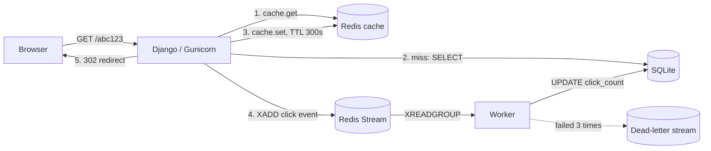

# URL Shortener

A Bitly-style URL shortener built with **Django**, **Redis** and **SQLite**.
Paste a long link, get a short one, share it, and watch the click counter go up.

## Problem statement

Long URLs are hard to share in messages, print, or social posts, and they give
no feedback on whether anyone used them. This project turns a long URL into a
short one, redirects visitors quickly, and records how often each link is used.
Redirects are the hot path (read-heavy), so the project uses Redis to answer
them without touching the database, and moves click counting off the request
path so a redirect is never slowed down by a database write.

## Features

- Shorten any `http://` or `https://` URL to `http://localhost:8000/<code>`
- Random 7-character Base62 codes with automatic collision handling
- Optional custom alias (`/my-link`) and optional expiry date
- Redirect with `302`; `404` for unknown codes; `410 Gone` for expired links
- **Redis cache** in front of the database (5 minute TTL, configurable)
- **Works without Redis** — falls back to the database automatically
- **Click analytics** through a Redis Stream + background worker, with retries and a dead-letter queue
- Per-URL statistics (clicks, creation date, expiry)
- Dashboard to list, copy and delete your links
- Accounts (sign up / log in with token authentication); each user only sees their own links
- Rate limiting on login, sign-up and link creation
- Input validation: unsafe schemes (`javascript:`, `file:`, `data:`, `ftp:`) are rejected, SQL injection is prevented by the Django ORM, configuration comes from environment variables
- Health endpoint, automated tests, Docker Compose setup

## Technology stack

| Part | Technology |
|---|---|
| Backend | Python 3.13, Django 6.1, Django REST Framework |
| Database | SQLite (file on a Docker volume) |
| Cache + queue | Redis 7 (`django-redis` for the cache, `redis-py` for Streams) |
| Frontend | Plain HTML, CSS, JavaScript (no framework), served by Django |
| App server | Gunicorn |
| Containers | Docker + Docker Compose |

## System architecture



Three containers in Docker Compose: `redis`, `web` (Django + Gunicorn) and
`worker` (`worker.py`). `web` and `worker` share the SQLite file through a
named volume.

## Folder structure

```
url-shortner/
├── config/                 Django project settings and root URL routes
│   ├── settings.py         All configuration (reads environment variables)
│   └── urls.py             /admin, /api/, /app/ (frontend), /<code> (redirect)
├── shortener/              The application
│   ├── models.py           URL and ClickEvent tables
│   ├── views.py            API endpoints + the redirect view
│   ├── services.py         Creating short URLs, recording clicks
│   ├── serializers.py      Input validation
│   ├── queue.py            Redis Stream client (click events)
│   ├── rate_limit.py       Fixed-window rate limiter on top of the cache
│   ├── utils.py            Random Base62 code generator
│   ├── urls.py             /api/... routes
│   ├── tests.py            Automated tests
│   └── migrations/         Database schema history
├── frontend/               login.html, dashboard.html, script.js, style.css
├── worker.py               Click-analytics consumer (Redis Stream -> database)
├── Dockerfile              Image for web and worker
├── docker-compose.yml      redis + web + worker, volumes, health checks
├── requirements.txt        Python dependencies
├── .env.example            Template for your .env
└── manage.py               Django command-line tool
```

## How URL shortening works

1. The user submits a long URL (`POST /api/shorten/`).
2. The serializer validates it: it must be a well-formed `http`/`https` URL of at most 2048 characters. An expiry must be in the future and an alias may only contain letters, digits, `-` and `_` (and not `api`, `admin`, `app`, `static`).
3. A random 7-character code is generated from the Base62 alphabet (`0-9A-Za-z`) with Python's `secrets` module. That is 62⁷ ≈ 3.5 trillion codes, and random codes cannot be guessed by counting upwards.
4. The code is inserted into the database. The `code` column has a **UNIQUE** constraint, so if the code already exists the insert fails and the service simply tries another code (up to 5 times). Letting the database decide is safe even when two requests arrive at the same moment; checking "does it exist?" first would not be.
5. The API returns `{"short_url": "http://localhost:8000/<code>"}`.

## How Redis caching works

Every redirect to `/<code>` follows this path (`shortener/views.py`, `redirect_url`):

1. Look in Redis for the key `url:<code>`.
2. **Hit** → use the cached `{url_id, original_url, expires_at}`. No database query.
3. **Miss** → query the database (`404` if the code does not exist), then store the mapping in Redis with a TTL of `CACHE_TTL_SECONDS` (default 300). If the link expires sooner than that, the TTL is shortened so a cached entry never outlives the link.
4. Expiry is checked on every request, including cache hits.
5. Deleting a URL also deletes its cache key, so it stops redirecting immediately.

Each redirect response carries an `X-Cache: HIT` or `X-Cache: MISS` header, which makes the behaviour easy to verify with `curl -I`.

**When Redis is down:** the cache is configured with `IGNORE_EXCEPTIONS`, so a failed `cache.get` behaves like a miss and the database is used. Timeouts are 1 second and retries are disabled, so a redirect with Redis down takes milliseconds, not seconds. Clicks are written straight to the database, and the rate limiter lets requests through. `GET /api/health/` reports `"status": "degraded"`.

Redis uses two logical databases: **db 0** for the click stream, **db 1** for the cache.

## How click analytics work

Updating a database row on every redirect would slow the redirect down, so it is done asynchronously:

1. On each `GET /<code>` the web app appends an event `{url_id}` to the Redis Stream `shortener:clicks:stream` (`XADD`) and redirects immediately. `HEAD` requests and failed lookups are not counted.
2. `worker.py` reads the stream as part of the consumer group `analytics-workers` (`XREADGROUP`). For each event it inserts a `ClickEvent` row (its `event_id` is the Redis message ID and is **unique**) and increments `URL.click_count` in the same transaction. If Redis delivers the same event twice, the unique `event_id` makes the second one a no-op, so clicks are never double-counted.
3. A successful event is acknowledged (`XACK`). Events that a crashed worker read but never acknowledged are reclaimed after 10 seconds (`XAUTOCLAIM`).
4. An event that fails 3 times is moved to the dead-letter stream `shortener:clicks:dead` instead of blocking the queue.
5. If Redis is unavailable at redirect time, the web app increments `click_count` directly in the database.

Clicks therefore show up a moment after the redirect (usually well under a second), not instantly.

## API documentation

Authenticated endpoints need the header `Authorization: Token <token>`.

| Method | Endpoint | Auth | Purpose |
|---|---|---|---|
| POST | `/api/register/` | no | Create an account, returns a token |
| POST | `/api/login/` | no | Log in, returns a token |
| POST | `/api/shorten/` | yes | Create a short URL |
| GET | `/api/my-urls/` | yes | List your URLs (newest first) |
| GET | `/api/urls/<code>/` | yes | Statistics for one URL |
| DELETE | `/api/urls/<code>/delete/` | yes | Delete a URL |
| GET | `/<code>` | no | Redirect to the original URL |
| GET | `/api/health/` | no | Health of the app, database and Redis |

The trailing-slash form `/<code>/` also redirects, so older links keep working.

**Register / login** — body `{"username": "demo", "password": "Demo-Pass-2026"}` → `{"token": "…"}`.
Errors: `400` (invalid or weak password, username taken), `401` (wrong credentials), `429` (rate limited).

**Shorten** — body:

```json
{
  "url": "https://example.com/some/long/path",
  "custom_alias": "my-link",
  "expires_at": "2027-01-01T00:00:00Z"
}
```

`custom_alias` and `expires_at` are optional. Success → `201 {"short_url": "http://localhost:8000/my-link"}`.
Errors: `400` validation (bad URL, unsafe scheme, bad or reserved alias, past expiry), `409` alias already taken, `429` more than 10 per minute, `503` no free code found.

**Stats** (`/api/urls/<code>/`) →

```json
{
  "code": "my-link",
  "original_url": "https://example.com/some/long/path",
  "click_count": 12,
  "created_at": "2026-11-04T09:00:01.644575Z",
  "expires_at": null
}
```

`/api/my-urls/` returns a list of the same objects. Both return `404` for codes that do not exist **or belong to someone else**.

**Delete** → `204` on success, `404` otherwise.

**Redirect** → `302` with `Location`, `404` unknown code, `410` expired link.

**Health** → `{"status": "ok" | "degraded" | "down", "database": "up", "redis": "up"}`. `200` unless the database is down (`503`).

### Try every endpoint with curl

```bash
BASE=http://localhost:8000

# 1. Sign up (or use /api/login/) and keep the token
TOKEN=$(curl -s -X POST $BASE/api/register/ -H "Content-Type: application/json" \
  -d '{"username":"demo","password":"Demo-Pass-2026"}' | python -c "import sys,json; print(json.load(sys.stdin)['token'])")

# 2. Shorten
curl -s -X POST $BASE/api/shorten/ -H "Authorization: Token $TOKEN" \
  -H "Content-Type: application/json" -d '{"url":"https://www.python.org/about/"}'
# -> {"short_url":"http://localhost:8000/DsM7Hsw"}

# 3. Redirect (twice: first X-Cache: MISS, then X-Cache: HIT)
curl -i http://localhost:8000/DsM7Hsw

# 4. Statistics and list (clicks update a moment after the redirect)
curl -s $BASE/api/urls/DsM7Hsw/ -H "Authorization: Token $TOKEN"
curl -s $BASE/api/my-urls/      -H "Authorization: Token $TOKEN"

# 5. Invalid input -> 400
curl -s -X POST $BASE/api/shorten/ -H "Authorization: Token $TOKEN" \
  -H "Content-Type: application/json" -d '{"url":"javascript:alert(1)"}'

# 6. Unknown code -> 404
curl -i $BASE/doesnotexist

# 7. Delete, then the link is gone (404)
curl -i -X DELETE $BASE/api/urls/DsM7Hsw/delete/ -H "Authorization: Token $TOKEN"
curl -i $BASE/DsM7Hsw

# 8. Health
curl -s $BASE/api/health/
```

On Windows PowerShell use `curl.exe` instead of `curl`, or use a tool such as Postman.

## Environment variables

Copy `.env.example` to `.env` and edit it. `.env` is in `.gitignore` and must never be committed.

| Variable | Default | Meaning |
|---|---|---|
| `SECRET_KEY` | *(required)* | Django secret key. The app refuses to start without it |
| `DEBUG` | `False` | `True` for local development only |
| `ALLOWED_HOSTS` | `127.0.0.1,localhost` | Comma-separated host names the app answers to |
| `REDIS_HOST` | `127.0.0.1` | Redis host. Docker Compose overrides this to `redis` |
| `REDIS_PORT` | `6379` | Redis port |
| `SQLITE_PATH` | `./db.sqlite3` | Database file. Docker Compose sets `/data/db.sqlite3` |
| `CACHE_TTL_SECONDS` | `300` | How long a code stays cached |
| `CORS_ALLOWED_ORIGINS` | empty | Only needed if you serve the frontend from another origin |

Generate a secret key with:

```bash
python -c "from django.core.management.utils import get_random_secret_key as g; print(g())"
```

## Installation

```bash
git clone https://github.com/deeksha00-dot/url-shortener.git
cd url-shortener
cp .env.example .env          # Windows: copy .env.example .env
```

Edit `.env` and set a real `SECRET_KEY`.

## Run with Docker (recommended)

Requires Docker Desktop / Docker Engine with Compose v2.

```bash
docker compose up --build
```

This starts Redis, runs the database migrations, starts the web server on port 8000, and starts the click worker. Open <http://localhost:8000>, click **Create an account**, and start shortening.

Useful commands:

```bash
docker compose ps                  # all three services should be "healthy"/"running"
docker compose logs -f worker      # watch clicks being processed
docker compose logs -f web         # watch CACHE HIT / CACHE MISS lines
docker compose down                # stop (data is kept in volumes)
docker compose down -v             # stop AND delete all data
```

Data lives in two named volumes: `sqlite_data` (the database) and `redis_data`.
Inside the containers Redis is reached at host **`redis`** (the Compose service name), never `localhost`.

To prove the Redis fallback, run `docker compose stop redis`, click a short link (it still redirects), then `docker compose start redis`.

## Run locally (without Docker for the app)

You need Python 3.12+ and a Redis server. The easiest way to get Redis is Docker:

```bash
docker compose up -d redis
```

Then, in a terminal:

```bash
python -m venv venv
venv\Scripts\activate             # Windows        (macOS/Linux: source venv/bin/activate)
pip install -r requirements.txt
python manage.py migrate
python manage.py runserver        # http://localhost:8000
```

In a **second terminal** (same venv) start the click worker:

```bash
python worker.py
```

Without the worker the app still works, but click counts are only updated when Redis is down. Without Redis at all the app also works (database only).

You can create an admin user for `/admin/` with `python manage.py createsuperuser`.

## Testing

```bash
python manage.py test
```

47 tests cover: URL creation and validation (empty, malformed, `javascript:`, `file:`, `ftp:`, over-long, SQL-injection strings), unique codes and collision retries, custom aliases (invalid, reserved, duplicate), redirects (`302`/`404`/`410`), cache miss → hit, cache TTL, cache invalidation on delete, click counting, the worker's idempotency, the database fallback when Redis is down (including that it stays fast), statistics, listing, ownership checks, deleting, sign-up/login, rate limiting and the health endpoint.

Most tests need no Redis. One group (`RedisIntegrationTests`) uses a real Redis server and is skipped automatically when none is running; start one with `docker compose up -d redis` to include it.

## Screenshots

Add your own screenshots to a `docs/screenshots/` folder and reference them here:

```markdown


```

Suggested shots: the login/sign-up page, the dashboard after creating a link, the URL list with click counts, and `docker compose ps` showing the three services.

## Limitations

- **SQLite** is used for simplicity. The web and worker containers share one file, which is fine for a demo but not for heavy concurrent writes; switch to PostgreSQL for real traffic.
- Django's `static.serve` view serves the frontend. It is correct but not optimised; put Nginx or WhiteNoise in front for production.
- If Redis is down while a link is *deleted*, a stale cache entry may survive on the Redis side until its TTL (at most 5 minutes) runs out.
- Rate limiting is keyed on the client IP as Django sees it. Behind a reverse proxy this needs the proxy's forwarded address to be configured.
- No password reset or email verification.

## Future improvements

- PostgreSQL and database connection pooling
- QR code generation for each short link
- Click analytics over time (per day, referrer, country) using the existing `ClickEvent` table
- Link editing, bulk import/export, and password reset by email
- Prometheus metrics and structured logging
- GitHub Actions workflow to run the tests on every push
